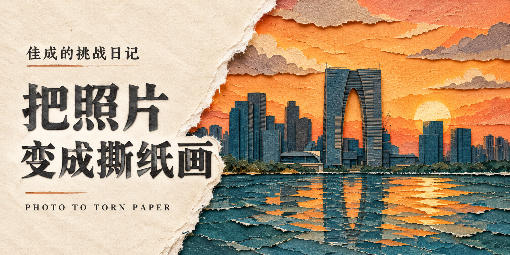

# Photo to Torn Paper

**One photo. Four ways to tear the paper.**

Created and maintained by **佳成的挑战日记 — Jiacheng's Challenge Diary**.

[中文](README.md) · [Try without installing](TRY_IT.md) · [Download the skill](https://github.com/zhu135531-hue/photo-to-torn-paper/releases/latest/download/torn-paper.zip) · [Security](SECURITY.md)



Turn a photograph into a full-bleed illustration built from textured paper, torn fibers and shallow overlapping shadows. Keep the original composition, subject scale and palette. Each variant changes the dominant tear, rather than merely recoloring the scene.

This repository shares instructions, a prompt skeleton and nine tear events. **It does not include model weights, an API client or guaranteed image-generation access.** Use an image-capable host that can accept a reference photograph.

## Quick start

For the photo-only workflow, download [photo-studio.zip](https://github.com/zhu135531-hue/photo-to-torn-paper/releases/latest/download/photo-studio.zip), extract it, and open **photo-studio** in Cursor or TRAE. Start a local Agent chat and send a photograph. The bundled project rule supplies the request; no per-photo prompt or slash command is intended. See [platform setup and verification status](INSTALL.md).

Portable ZIP packages support skill import, including a root-level SKILL.md for TraeWork. WorkBuddy can bind the enabled skill to a dedicated expert. Ordinary Doubao chat has no verified GitHub skill-installation route in this project; its dedicated image-capable agent must be configured and tested first. Packaging alone does not establish end-to-end compatibility.

### Manual fallback

Upload your own photo in a reference-image editing tool and try:

```text
Rebuild this photo as one full-bleed layered torn-paper illustration.
Keep its aspect ratio, composition, subject scale, identifying features and palette.
Make every surface paper, including water, bark, clothing and skin.
Use one dominant physically plausible tear along an existing object boundary;
keep other edges clean-cut, without uniform white sticker outlines.
Keep people intact. Preserve bridge openings, connected branches and aligned reflections.
No added words, watermarks, people or landmarks. Produce one image, not a grid.
```

For the full agent workflow, download and extract the `torn-paper` skill folder. Copy it into your host's supported skill directory. Codex uses `.agents/skills/torn-paper` for a project; Cursor uses `.cursor/skills/torn-paper`. See the [installation guide](skills/torn-paper/README.md). Then explicitly invoke the skill with a reference photo and request four separate images.

## What has been tested

In a Codex session with the built-in image-generation tool, we explicitly loaded this skill and tested two photos: a magnolia courtyard and a canal with a stone bridge. Eight final images were retained after two targeted corrections. See [testing notes](TESTING.md).

In Cursor local IDE Agent, a fresh studio chat received only a canal photograph, with no text. It loaded the workflow, generated four real images, retried two, and saved four JPEGs. The output was 1152×864 (4:3), rather than the source's approximately 3:2; some tear placement and color details also drifted. This verifies the photo-only execution path, not full visual fidelity or compatibility across accounts.

In TraeWork CN, we imported the published root-level ZIP, enabled torn-paper, and sent only the canal photograph in a new default local task. It automatically invoked the skill and delivered four separate JPEGs, each saved at 2400×1600. Files decoded successfully and opened in the side-panel preview. Some tears, reflections and colors still drifted; platform AI labels remained. Four simultaneous inline previews and the generation tool's native versus saved dimensions were not independently verified.

WorkBuddy v5.8.3 has imported and enabled the portable skill. Its photo-only generation test is pending, with no verified image output yet. Installation is not recorded as a generation pass or a security certification. Doubao's dedicated entry and fresh-session automatic discovery in Codex remain unverified. Output varies by host and model; an enlarged export is not described as native 4K.

## Privacy and security

Generation sends your selected photo and prompt to your chosen image service. The optional local collection helper makes no network calls and does not execute shell commands, but it decodes images and copies approved files. Its path roots must be supplied explicitly, outputs stay inside the authorized workspace, and prompts are excluded from logs by default. See [security boundaries](SECURITY.md) and the [self-review](docs/SECURITY_REVIEW.md).

## Share what works

Reproduction reports, improvements and honest failures are welcome. Use [Issues](https://github.com/zhu135531-hue/photo-to-torn-paper/issues) to tell us your host, model, prompt adjustments and outcome; upload images only if you have permission and want them to be public. Starring or sharing the project is optional.

Suggested optional credit: “Workflow by 佳成的挑战日记 / Jiacheng's Challenge Diary.” No brand watermark is added to ordinary output.

Skill instructions, prompts and documentation: [MIT](LICENSE). Showcase images in `examples/` and brand artwork in `assets/` are excluded from the MIT grant; contact the creator before reusing those images. Your own photos and generated images remain subject to their applicable rights and platform terms.
