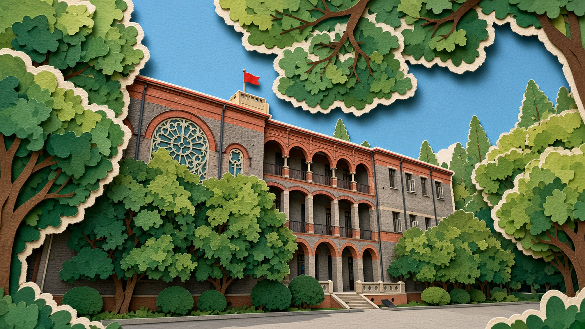
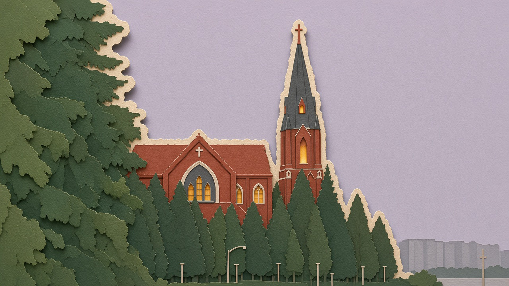
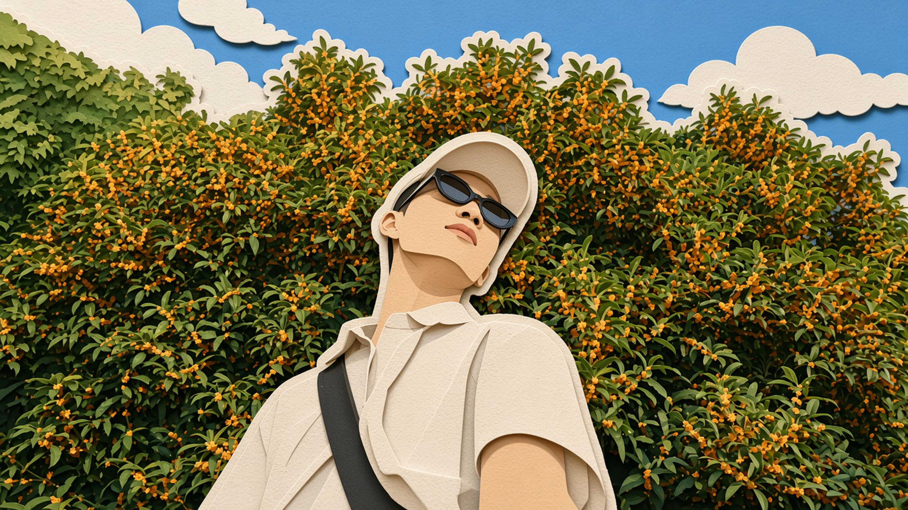
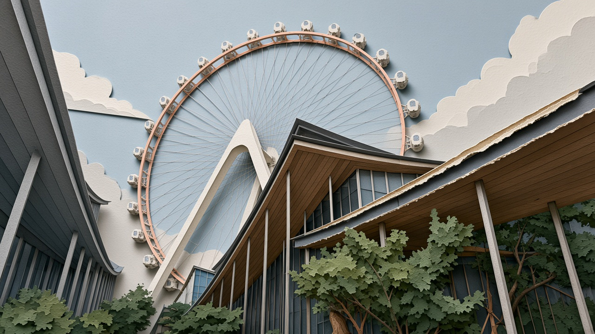
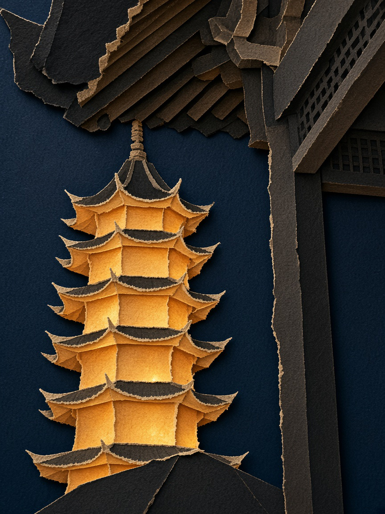
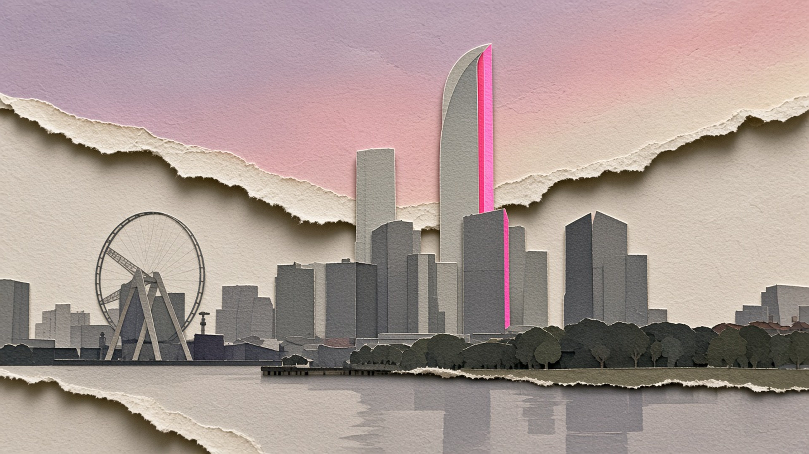
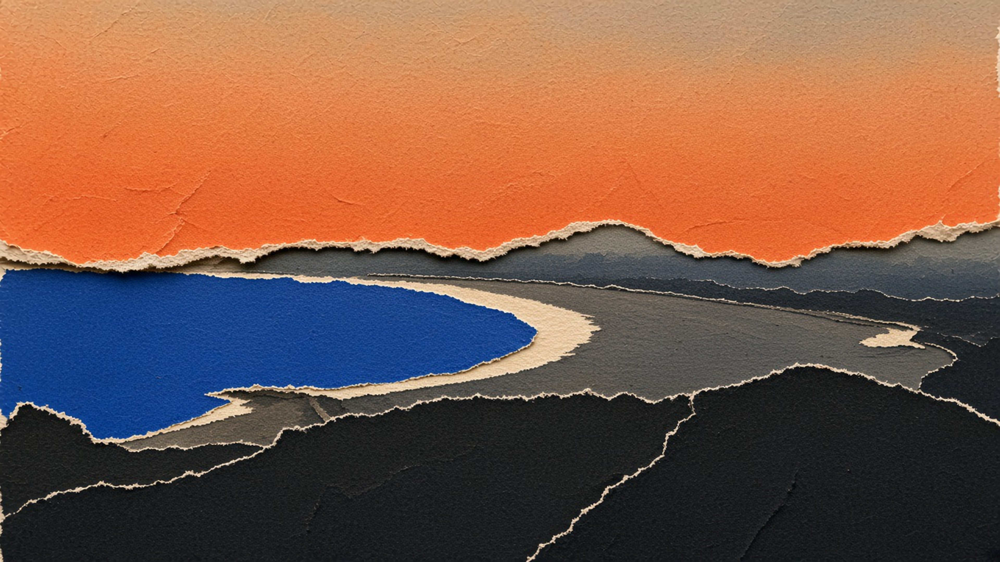
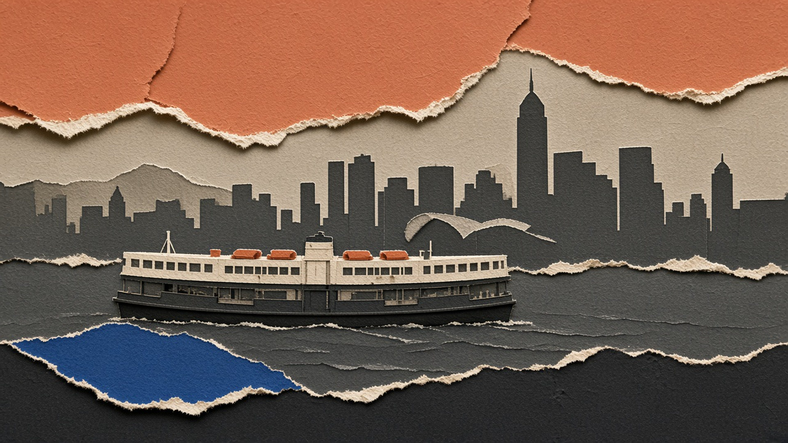
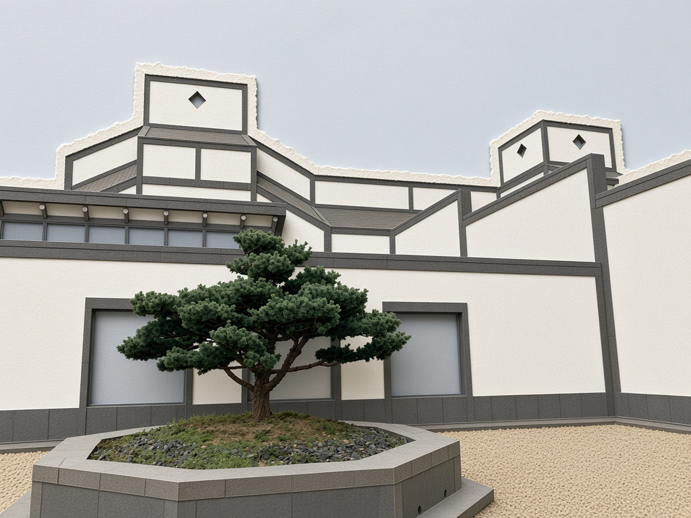

# 撕纸 · 佳成的挑战日记

**一张照片，四种撕纸。把喜欢的创作方法，分享给每一个想试试的人。**

[English](README.en.md) · [免安装提示词](TRY_IT.md) · [下载技能包](https://github.com/zhu135531-hue/photo-to-torn-paper/releases/latest/download/torn-paper.zip) · [安全说明](SECURITY.md) · [参与共创](CONTRIBUTING.md)


把一张实拍照片，重新做成有纸张纹理、撕裂纤维和叠层阴影的画面。

保留熟悉的建筑、人物和构图，让天空、树木、水面与主体变成一层层纸。默认做四种撕口，也可以只做一张。

由 **[佳成的挑战日记](https://github.com/zhu135531-hue)** 创作与维护。我们记录真实尝试、公开方法，也记录没有做好的部分。

## 从这里开始

这是从作者在 Cursor 中整理的工作流提取的独立 Agent Skill，包含技能说明、视觉规则、九种撕口和提示词骨架。**需要配合能接收参考照片、生成图片的 AI 工具使用。技能本身不包含图像模型、模型权重或自动调用 API 的程序。**

只想马上试效果：打开[免安装提示词](TRY_IT.md)，上传自己的照片，复制提示词即可尝试。不需要先学 GitHub。想让代理按完整规则工作，再下载技能包。

图片生成会把所选照片和提示词发送到你使用的图像服务。技能里的可选复制脚本只在本地工作，无联网、密钥收集或遥测；这不表示生图过程完全离线。具体安全边界与此次修复见 [SECURITY.md](SECURITY.md) 和 [安全复查记录](docs/SECURITY_REVIEW.md)。

- [技能与安装说明](skills/torn-paper/README.md)
- [完整技能指令](skills/torn-paper/SKILL.md)
- [提示词骨架](skills/torn-paper/references/prompt.md)
- [九种撕口](skills/torn-paper/references/tear-events.md)
- [视觉规则与常见失败](skills/torn-paper/references/visual-system.md)
- [Codex 运行说明](skills/torn-paper/references/codex.md)
- [2026-10-18 实测记录与已修问题](TESTING.md)

## 不会编程也能试

1. 点击本页上方绿色 **Code → Download ZIP**，解压。
2. 打开一个 Cursor 项目，将下载文件夹里的 `skills/torn-paper` 整个文件夹复制到该项目的 `.cursor/skills/` 下。
3. 最后应能看到 `.cursor/skills/torn-paper/SKILL.md`，以及旁边的 `references` 文件夹。
4. 新开对话，上传自己的照片，让支持图像生成的代理读取这个技能，然后说：

```text
使用 torn-paper 技能，把这张照片做成四种撕纸。
保持原照片的构图、主体大小、颜色和横竖比例。
```

只想做一张，可以说：

```text
只做一张，撕口沿着天际线，倒影留在下面那张纸上。
```

做人像，可以补充：

```text
撕口不要经过身体，把人和后面的树分开。
```

如果你的工具没有技能安装功能，也可以阅读[提示词骨架](skills/torn-paper/references/prompt.md)，按照片内容填写方括号，并把照片一起交给支持参考图的图像模型。每次先做一种撕口。

### 在 Codex 中使用

将完整 `skills/torn-paper` 文件夹复制到当前项目的 `.agents/skills/torn-paper`，或用户级 `~/.agents/skills/torn-paper`。这是当前[官方技能文档](https://learn.chatgpt.com/docs/build-skills)说明的本地发现目录。

也可直接要求 Codex 读取仓库里的 `skills/torn-paper/SKILL.md` 和引用文档，然后处理附件。2026-10-18 已用这种显式读取方式，在有内置生图工具的 Codex 会话中完成两张照片各四种撕口的实测；这不等于验证了新会话自动发现，也不代表所有 Codex 环境都提供生图。

## 风格怎么保持

- 主体仍占原来那么大的画面，建筑和人物保持可辨认。
- 整幅画面转为纸张材质，避免把写实人脸直接贴在纸人上。
- 颜色跟随照片；窄窄的暖白纸纤维出现在撕口。
- 阴影用来表达纸张叠层，撕口要能解释为两层纸的分离。
- 人像作为完整的一层纸，撕口避开脸、衣服、手臂和背带。
- 默认四张共用构图与材质，主要改变撕口的位置和方式。

## 作品展示

这些是作者提供的风格探索成品，用来说明不同场景与纸感处理；它们不代表所有图片都严格满足当前技能规则，也不是一次完整、固定参数的复现实验。点击图片可以查看原文件。

### 建筑与树木






### 人像与复杂结构







### 城市、水面与大块撕纸







### 更多纸感探索




苏博示例保留了较多写实细节，可与前面的完全纸化效果对照。

## 关于复现和分辨率

最初 12 张展示图来自作者的风格探索，创作环境包含 Cursor；其具体图像模型、版本、逐图原始提示词、随机种子与后期处理记录尚未完整核实。

2026-10-18 另用作者提供的两张新照片在 Codex 内置生图工具中实测：生成八张独立版本，其中两张各定向修正一次。最终八张已目视检查，并通过图片解码、比例与复制校验；实际提示词和结果保存在本地运行记录中。新照片及测试成品未上传本仓库。详见 [TESTING.md](TESTING.md)。

同一提示词在不同模型、版本或多次生成中会有差异。本项目用于复现风格和工作方法，不保证像素一致，也不表示仅安装技能就能在所有代理里直接生图。

当前技能默认保留工具返回的原生尺寸，不再自动放大或添加 `4k` 文件名。最初示例包含不同尺寸，其中 `4k` 文件名不作为模型原生分辨率声明。

## 一起完善

欢迎在 [Issues](https://github.com/zhu135531-hue/photo-to-torn-paper/issues) 分享复现结果、问题与改进。建议写明工具、模型、生成日期、提示词修改，以及哪些地方成功或失败。只上传你愿意公开且有权分享的照片。

如果它帮你做出了喜欢的作品，欢迎自愿 Star、分享项目链接，或提交复现经验。我们更希望大家能实际用好它；不同平台的成功与失败都值得记录。

分享时可自愿使用署名：**“方法来自：佳成的挑战日记 · Photo to Torn Paper”**。这不是新增的使用限制；技能继续按 MIT 开放，普通成品默认不加水印。下载包内的作者说明也保留出处。

## 许可

技能、提示词和本项目说明文档使用 [MIT License](LICENSE)。原技能目录内也保留了原始许可。

`examples/` 中的图片和 `assets/` 中的品牌视觉用于作品展示，**不纳入 MIT 授权**；转载、修改或商业使用这些图片，请先联系作者。欢迎分享项目链接。模型服务和你自己上传的照片仍适用各自的条款与权利要求。

本仓库只收录独立的 torn-paper 技能，不包含其他纸刊技能，也不对其他项目重新授权。
